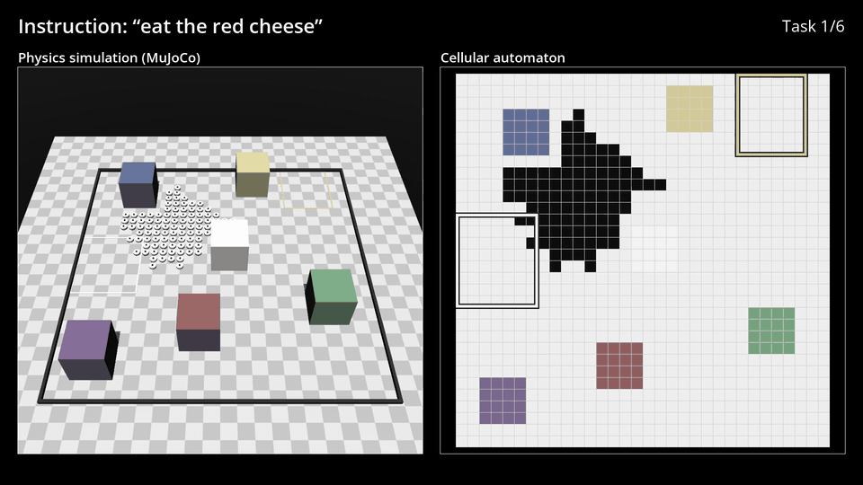

# cellbot

One language model steers a swarm of about 100 robots from plain English. Each step it reads the
instruction and the whole grid, and gives every cell a move.



- **Weights:** [huggingface.co/fringewidth/cellbot1](https://huggingface.co/fringewidth/cellbot1)
- **Live demo:** [huggingface.co/spaces/fringewidth/cellbot](https://huggingface.co/spaces/fringewidth/cellbot)

## What it does

The world is a 32 x 32 grid. Each square holds at most one robot, and there are walls, coloured
cheeses (4 x 4 squares) and coloured boxes drawn on the floor. Each step, every robot moves to one of
its 8 neighbours or stays. A cheese slides when enough robots push it together, and it is eaten when
robots surround it. You type an instruction ("eat either yellow or purple", "go into the blue box",
"move left") and the policy moves the swarm until it is done. A new instruction can be typed at any
time and the swarm changes course.

The same policy runs in [MuJoCo](https://mujoco.org), with rigid robots and cheeses. Each step the
physics is snapped to the grid, which is all the policy ever sees. The video shows both worlds side by
side: the physics on the left, the grid (a cellular automaton) on the right.

## Results

Fresh scenes, 8 rollouts per instruction, success counted by each task's own checker (score at least
0.99 at the end of the run, and no cheese eaten that was not asked for):

| instruction | MuJoCo | raw grid |
| --- | --- | --- |
| eat the red cheese | 8/8 | 7/8 |
| eat either yellow or purple | 7/8 | 7/8 |
| clear the board of cheese | 7/8 | 6/8 |
| go into the blue box | 7/8 | 8/8 |
| move left | 7/8 | 7/8 |
| steering: "go into the blue box", then "eat the red cheese", then "move left", each replaced mid-motion | last one met 6/8 | last one met 7/8 |

In the steering run, all three commands were met in 2/8 rollouts in each world.

The checkpoint is undertrained. Training stopped when compute ran out, with the validation loss still
falling (0.40 at the start of the last stage, 0.31 at its last checkpoint).

## How it works

1. **Policy** (`cellbot.policy`). Qwen3-0.6B with a rank-64 LoRA. The instruction goes in as text
   tokens. The grid (10 channels: robots, walls, cheese mask and colour, box mask and colour) goes in as
   64 patch tokens of 4 x 4 squares, with learned row and column embeddings. Text tokens stay causal
   among themselves, so the LM's language behaviour is unchanged. Scene tokens attend to everything.
   A linear readout turns each scene token into 16 squares x 9 moves. One move per robot is sampled
   from it every step, with classifier-free guidance 2.0 against the same scene with no instruction.
1. **Tasks** (`cellbot.tasks`). Generated scenes and instruction families: eat cheeses by colour and
   by logic (either, all but, in order, nearest to a box), go into a box, go to a region, move in a
   direction, form a shape or a letter, herd a cheese into a box, catch a cheese that runs away, split
   into two groups. Each family has a programmatic checker. Some wordings and compositions are held
   out of training.
1. **Experts** (`cellbot.experts`). Scripted experts turn a task into attractor points. One shared
   controller turns the attractors into a move for every square. Their episodes are the
   demonstrations.
1. **Training** (`cellbot.training`). Behaviour cloning on the expert demonstrations, mixed with
   captioned play episodes and with distillation of the frozen LM on general text, so the language
   side is not lost. About 40 T4 hours in total. See [docs/TRAINING.md](docs/TRAINING.md).
1. **Physics** (`cellbot.sim.mujoco_world`). Robots are flat cylinders on slide joints. Cheeses are
   boxes whose friction takes three robots to overcome, as on the grid. Each policy step drives every
   robot toward its chosen neighbour square for one simulated second, then snaps the scene back to
   the grid.

More on the design, and on what did not work, in [docs/HOW_IT_WORKS.md](docs/HOW_IT_WORKS.md).

## Run it

```sh
git clone https://github.com/fringewidth/cellbot && cd cellbot
uv sync                     # or: pip install -e .
```

Run one instruction and save a video in the demo's style. This downloads Qwen3-0.6B and the cellbot1
weights from Hugging Face on first use. It runs on CUDA, Apple MPS or CPU.

```sh
uv run python -m cellbot.demo.live "eat the red cheese" --out runs/live.mp4
uv run python -m cellbot.demo.live "go into the blue box" "move left" --steps 60 --out runs/steer.mp4   # one command after another
uv run python -m cellbot.demo.live --task 5 --out runs/video-task.mp4                                  # a task from the video, on its scene
```

Use the policy directly:

```python
import numpy as np
import torch

from cellbot.policy.inference import lm_sampler, load_policy, tokens
from cellbot.sim.world import observe, step
from cellbot.tasks import suite as T

device = torch.device("cpu")
policy, tokenizer = load_policy("fringewidth/cellbot1", device)
sample = lm_sampler(policy, guidance=2.0, n=T.SIZE // 4)

scene = T.sample_scene(np.random.default_rng(0), cheeses=(1, 4), boxes=(0, 2))
world, _ = T.stack([scene])
cond = tokens(tokenizer, ["clear the board of cheese"], device)
with torch.no_grad():
    for _ in range(100):
        _, field = sample(observe(world), cond)  # a move for every square
        world, info = step(world, field)
```

Reproduce the demo video: record 8 rollouts of each of the video's instructions in both worlds, then
render.

```sh
uv run python -m cellbot.demo.record --physics mujoco --out runs/demo/mujoco.json
uv run python -m cellbot.demo.record --physics grid --out runs/demo/grid.json
uv run python -m cellbot.demo.render --recordings runs/demo/mujoco.json --grid runs/demo/grid.json --out runs/demo/cellbot1.mp4
```

Tests: `uv run pytest -q`.

## Layout

```
src/cellbot/
  sim/        world.py (the grid: robots, walls, cheeses, boxes, pushing, eating), mujoco_world.py
  tasks/      suite.py (scenes, instruction families, checkers), facts.py, goal_eval.py, shapes.py,
              grounding.py, wordings.json (held-out paraphrases)
  experts/    attractor.py (scripted experts, demonstration stores), controller.py
  policy/     model.py (the LM policy), inference.py (loading, sampling), actions.py (the move codes)
  steer.py    many swarms stepped together, each with its own instruction
  demo/       record.py, render.py (the video), live.py (one run on demand; the Space uses it)
  training/   expert_sft.py (the last stage), lm_train.py (the first), play data and captions,
              rl.py (RL on robot actions; it did not help), custom_*.py (the model before the LM,
              whose data code the LM trainers reuse)
space/        the Hugging Face Space
tests/
```

## Limitations

1. Cheeses in corners and pockets are hard to push or surround.
1. Free text far from the task families gets an attempt, but nothing checks it.
1. The grid is 32 x 32 with up to 6 cheeses and 3 boxes. The policy sees only the current frame.
1. Nothing here has run on real robots.

## License

Code and weights: Apache-2.0. The base model,
[Qwen3-0.6B](https://huggingface.co/Qwen/Qwen3-0.6B), is Apache-2.0. Open Sans
(`src/cellbot/demo/fonts/`) is under the SIL Open Font License.
