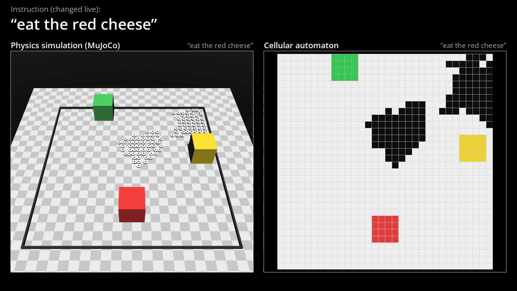

# cellbot

cellbot1 is Qwen3-0.6B post-trained to control a swarm of about 100 robots from text. At every step it
reads an instruction and the current state of a 32×32 cellular grid, and outputs a distribution over
9 moves for every cell.



The run above is one swarm in MuJoCo given five instructions in turn: "eat the red cheese", "eat the
green cheese", "stop", "move to the top right corner", "clear the board". Each instruction is replaced
by the next while the swarm is still moving.

[Live demo](https://huggingface.co/spaces/fringewidth/cellbot) · [Weights](https://huggingface.co/fringewidth/cellbot1) · [Training details](docs/TRAINING.md)

## Setup

The world is a 32×32 grid. Each cell holds at most one robot. A scene also has walls, up to 6
coloured cheeses (4×4 cells each) and up to 3 coloured boxes, which are rectangles marked on the
floor. At each step every robot either stays or moves to one of its 8 neighbours. A cheese slides one
cell when three or more robots push it in the same direction, and it is eaten when robots cover
enough of the cells around it.

The same scenes also run in MuJoCo. There the robots are rigid discs driven toward the cell their
move points to, and the cheeses are boxes with friction that takes three robots to overcome. After
one simulated second, positions are snapped back to the grid, and the model sees only that grid.

## Model

The grid is encoded as 10 channels: robots, walls, a cheese mask and its RGB colour, a box mask and
its RGB colour. It is split into 64 patches of 4×4 cells. Each patch is linearly projected to the
model's hidden size and given learned row and column embeddings. The instruction is tokenised
normally and placed before the patch tokens.

The attention mask keeps text tokens causal over text only, as in pre-training, while patch tokens
attend to all tokens. A linear layer maps each patch token's final hidden state to 16 cells × 9
moves, so one forward pass gives 9,216 logits regardless of how many robots there are. Each robot
samples the move of the cell it occupies.

At inference, each step also computes the logits with the instruction masked out and samples from
`null + 2 * (conditioned - null)` (classifier-free guidance).

The trained parameters are a rank-64 LoRA on every attention and MLP projection, plus the patch
projection, the position embeddings and the readout: about 41M in total. The base model's weights are
frozen.

Before settling on the linear readout, we compared it with a flow-matching action head of the kind
used in π0, on a smaller model trained from scratch. On held-out episodes the readout closed 84% of the
gap to replaying the recorded actions, against 61% for the flow head, and ran 2.4 times as many
training steps per minute.

## Post-training

Training data came from three sources.

1. Scripted experts. A task generator produces scenes and instructions from several families: eat a
   cheese by colour or by a logical condition (either, all but, in order, nearest to a box), go into
   a box or a region, move in a direction, form a shape or a letter, push a cheese into a box, catch
   a cheese that runs away, and split into two groups. Each family has a programmatic checker. For
   each task a scripted expert produces target points, and a shared controller turns them into a
   move per cell. The model is trained by behaviour cloning on these episodes.
1. Captioned play. LLM-written programs drove the swarm freely, and Claude Haiku 5.5 wrote four
   instructions of different lengths and styles for each segment of those episodes.
1. Distillation. On general text, instruction data and GSM8K problems, the model is trained to match
   the frozen base model's outputs (a KL loss), so that its language ability is preserved. Held-out
   perplexity was 28.0 at the start of the last run and 28.2 at the end.

The instruction is dropped in 10% of training examples, which gives guidance its unconditioned
baseline. Training used about 40 hours of Kaggle T4 time. It stopped when that compute ran out, with
validation loss still decreasing (0.40 to 0.31 over the last run), so the checkpoint is undertrained.
Hyperparameters and evaluation logs are in [docs/TRAINING.md](docs/TRAINING.md).

## Results

Each instruction was run on 8 fresh scenes. A run counts as a success if the task's checker is
satisfied at the end and no cheese was eaten that the instruction did not ask for. The model was
trained only on the grid, so the MuJoCo column measures transfer to physics it never saw.

| instruction | MuJoCo | grid |
| --- | --- | --- |
| eat the red cheese | 8/8 | 7/8 |
| eat either yellow or purple | 7/8 | 7/8 |
| clear the board of cheese | 7/8 | 6/8 |
| go into the blue box | 7/8 | 8/8 |
| move left | 7/8 | 7/8 |

For the five-instruction sequence shown above, run on 24 fresh scenes, all five instructions were
carried out in 12 runs and the last one in 21, both in MuJoCo and on the grid. An instruction counts as carried
out once it has visibly taken effect (the cheese eaten, the swarm halted, at least half of the swarm in the
corner) before the next one replaces it.

## Running it

```sh
git clone https://github.com/fringewidth/cellbot && cd cellbot
uv sync                                   # or: pip install -e .
uv run python -m cellbot.demo.server      # the live demo on a local GPU (cuda or mps), at http://127.0.0.1:8790
```

From Python:

```python
import numpy as np
import torch

from cellbot.policy.inference import lm_sampler, load_policy, tokens
from cellbot.sim.world import observe, step
from cellbot.tasks import suite as T

device = torch.device("cuda")  # or "mps", "cpu"
policy, tokenizer = load_policy("fringewidth/cellbot1", device)
sample = lm_sampler(policy, guidance=2.0, n=T.SIZE // 4)

scene = T.sample_scene(np.random.default_rng(0), cheeses=(1, 4), boxes=(0, 2))
world, _ = T.stack([scene])
world = world.to(device)
cond = tokens(tokenizer, ["clear the board"], device)
with torch.no_grad():
    for _ in range(100):
        _, field = sample(observe(world), cond)
        world, info = step(world, field)
```

`cellbot.demo.record` records rollouts and `cellbot.demo.render` turns them into videos like the one
above.

## Repository

| path | contents |
| --- | --- |
| `src/cellbot/policy/` | the model, loading and sampling |
| `src/cellbot/sim/` | the grid world and the MuJoCo version |
| `src/cellbot/tasks/` | task families, scene generation and checkers |
| `src/cellbot/experts/` | scripted experts and the shared controller |
| `src/cellbot/training/` | post-training code |
| `src/cellbot/demo/` | recording, rendering and the live demo server |
| `site/`, `deploy/` | the demo website and its Modal deployment |

Tests: `uv run pytest -q`.

## Limitations

Everything here is simulated, on a 32×32 grid. The model sees only the current frame. Cheeses in
corners or narrow pockets are hard to surround. Pushing a cheese to a chosen place is weak: on 32
fresh tasks each, the model pushed a cheese into the nearest corner it was asked for in 4, and moved
a cheese at least 2 cells in a named direction, without eating it, in 5
(`python -m cellbot.tasks.evaluate push`).

## License

Code and weights are Apache-2.0. The base model, Qwen3-0.6B, is Apache-2.0. Open Sans is under the SIL
Open Font License.
